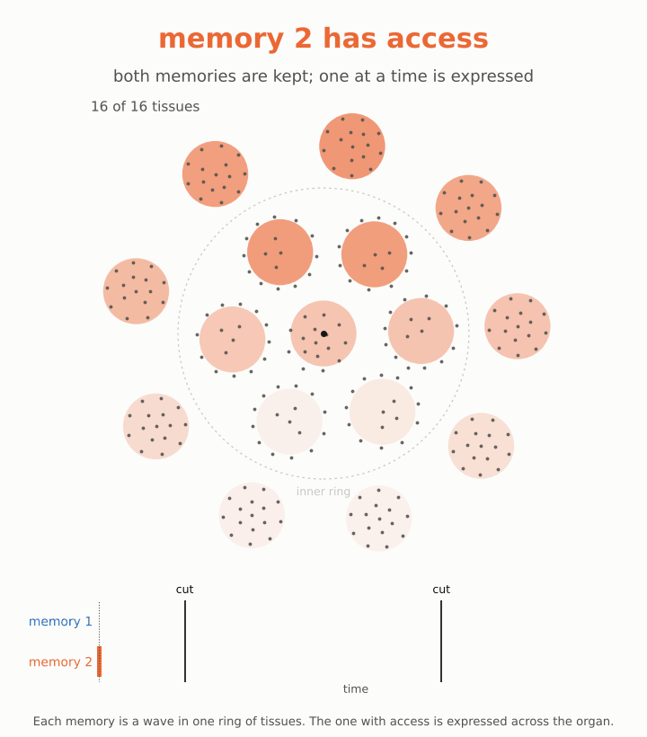
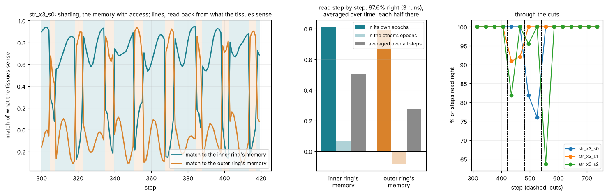

# AccessSwitching: an organ that keeps two memories through damage and lets them take turns

A growing active-inference organ (a Python port of Palacios, Razi, Parr, Kirchhoff and Friston 2020, grown
from one cell; see [Embryogenesis](https://github.com/dawsonzhou225/Embryogenesis)) that stores two bits and a
position in the phase waves of its tissues' clocks, keeps them through repeated cuts of most of its tissues,
and gives one bit at a time access to what its tissues express.  The last part was built after Hesse et al.
(2026), who found that the same IT and PFC neurons switch between the seen and the suppressed face about
15 times a second.

## The model in a few lines

- Every agent (cell, blanket, organ) runs the same ADEM step on one free energy (`spm.py`, `model.py`'s
  `adem_step`); the organ is 16 blankets of 16 cells, grown from one cell and repaired by the same rules.
- Each blanket believes it is one of two forms, A (1, 6, 9) or B (1, 3, 12); its cells' fingerprint, its
  birth target and its radii follow the belief.
- Each tissue (blanket) has a clock that sets its emission gain, 1 + 0.3 sin(phase).  The tissues near the
  core are the inner ring, the rest the outer; each ring's clocks couple by distance, so each ring carries a
  wave, phase = offset + winding x angle about the core.
- The bits: windings written at 150 (inner -1, outer +1), read back into each tissue's form, voted ring by
  ring; each tissue keeps a backup of the other ring's bit.  The position: a slow 2D walk added to each ring's
  clocks, so each wave's offset integrates the path; the two offsets are a point on a torus that the walk
  moves, as in a grid-cell module (Gardner et al. 2022).
- Repair: a new tissue's clock starts on its ring's wave; the core keeps a copy of each wave (a phase-locked
  loop) that holds a ring while it regrows; the coupling only moves phase within a ring; a tissue that moves
  round the core takes on its wave's phase where it arrives.
- Turn-taking (Hohwy, Roepstorff & Friston 2008): one bit at a time has access and is expressed on the
  tissues' emission as a pattern over the organ; the other builds up error, scaled by how clearly its ring
  shows it, until it takes over.  The threshold can follow the core's clock.

What is built in, not emergent: the forms' targets, the ring split, the write window, the walk, the repair
rules and the turn-taking rule.  What the runs test is whether they hold together in a growing, self-repairing
organ, and what the turn-taking looks like from inside it.

## Files

| file | what |
|---|---|
| `model.py` | the model: layout, process `Gg`, model `Mg`, `Fixed`, the ADEM step, `run(seed, nY, cuts, turns, pace, core_T)` |
| `spm.py` | the seven SPM primitives the step needs |
| `run.py` | run seeds in parallel, one JSON per run, every step traced |
| `fig.py` | the figures: `turns`, `rhythm`, `position`, `levelt` |
| `gif.py` | a GIF of the organ: cells by kind, tissues by form and gain, which memory has access |
| `run_all.sh` | the runs behind the figures, then the figures |
| `check_same.py` | are two run JSONs the same run, to the last bit? |
| `figures/` | the figures below, from the runs the code was checked against |

Requirements: numpy, scipy, matplotlib (Pillow for the GIF).  A 720-step run takes ~1.3 h (three at once).

## Running

    python3 run.py run --name turns_x3 --cut-at 420 480 540 --cut-n 12 --seeds 0-2 --cores 3 --out results
    python3 run.py run --name inner_x3 --cut-at 420 480 540 --cut-n 6 --cut-what inner --seeds 0-2 --cores 3
    python3 run.py run --name free --pace 0                # turn-taking not paced by the core's clock
    python3 run.py run --name noturns --no-turns           # the memories alone
    python3 fig.py turns results/turns_x3_s0.json results/turns_x3_s1.json --out turns.png

The schedule (`AT` in `model.py`): clocks from 150, the bits written until 180, votes and backups from 250,
turn-taking from 300, the walk from 380.  Cuts remove whole blankets with their cells, never the organ's core.

## What it can do

Seeds 0-2, 720 steps, cuts at 420, 480 and 540 unless noted.

**Grow and repair.**  It grows from one cell into an organ of 16 tissues of 16 cells, every cell, tissue and
the organ itself running the same free-energy step.  Each tissue works out which of two forms it belongs to
and reshapes to match.  After losing most of its tissues it regrows by the same rules that built it.

**Keep two bits through damage.**  Each bit is the way one ring's wave winds.  Both were held in every run:
12 of the 15 tissues around the core cut at random three times, the whole inner ring cut three times, with
turn-taking on and off.

**Keep a position.**  Each wave's offset integrates a slow 2D walk.  After three cuts made while walking, the
error at step 719 was at most 0.001 cycles.  The spikes during regrowth are a ring too sparse to read; the
core's copy carries the position then.

**Hold the memory in no tissue alone.**  A new tissue takes up its ring's wave from its neighbours, each tissue
keeps a backup of the other ring's bit, and the core keeps a copy of each wave that holds a ring while it
regrows.

**Give one memory at a time access.**  One bit at a time is expressed in what the tissues emit, and the two
take turns, straight through the cuts and the regrowth.  Which one has access can be read back step by step
from what the tissues sense, right on 97.6% of steps; averaged over time, each looks about half present.
That is the analysis of Hesse et al. in miniature: the memory without access looks weak on average, as if it
failed to ignite, but is fully there in its own epochs.

**Keep time with the core's clock** (seed 0, no cuts; measured before the last two changes, `run_all.sh`
remakes it).  When the core's clock paces the switching, the switches lock to its phase, best when one turn
fits a cycle: R 0.80, 0.63 and 0.40 for periods of 10, 17 and 25 steps, against 0.03 unpaced.  Each memory
still stays on about 8 steps whatever the period: the clock sets when switches happen, not how often.

**Follow Levelt's second law.**  Cutting only the inner ring weakens one memory.  An epoch then lasts as
(strength of the memory that is off)^-1.00 +- 0.15 and (its own)^-0.02 +- 0.17, as in binocular rivalry.
This follows from the turn-taking rule, but nothing was tuned to produce it: the strengths are measured from
how clearly each ring still shows its wave.

## Reproducibility

Runs are deterministic: every random draw comes from the seed.  `check_same.py a.json b.json` compares two
runs trajectory by trajectory with no tolerance.  This folder was cut from a larger research code base and
checked against it, run against run, with the turn-taking on and off, random and inner-ring cuts, and the
core's period changed; across machines the free energy's running sum differs in its 13th digit.

## References

Palacios, E. R., Razi, A., Parr, T., Kirchhoff, M., & Friston, K. (2020). On Markov blankets and hierarchical
self-organisation. *Journal of Theoretical Biology*, 486, 110089.

Hohwy, J., Roepstorff, A., & Friston, K. (2008). Predictive coding explains binocular rivalry: an
epistemological review. *Cognition*, 108(3), 687-701.

Gardner, R. J., Hermansen, E., Pachitariu, M., Burak, Y., Baas, N. A., Dunn, B. A., Moser, M.-B., & Moser, E. I.
(2022). Toroidal topology of population activity in grid cells. *Nature*, 602(7895), 123-128.

Hesse, J. K., Lanfranchi, F. F., McGrory, C., Shi, Y., Engel, T. A., & Tsao, D. Y. (2026). Rapid alternation of
conscious and suppressed stimulus representations in the primate brain. *bioRxiv*, doi:10.64898/2026.10.15.759299.
